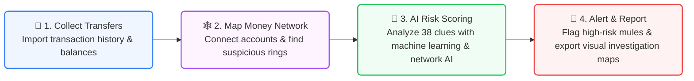

# Graph-Based Money Mule Detection System

**PaySim-first AML detection project**  
*Detects coordinated mule networks and suspicious mule behaviour using graph analytics and machine learning on PaySim transaction data.*

---

## Overview

This project builds an account-level mule detection pipeline on top of the PaySim transaction dataset. It:
- loads and normalizes PaySim transactions
- constructs a directed money-flow graph
- engineers behavioral, temporal, and graph features
- trains classical ML models and an optional GraphSAGE GNN
- scores suspicious accounts and writes reports, plots, and prediction files

Current project status:
- `GNN-SAGE` is the strongest validated detector on the 100k PaySim benchmark
- `RandomForest` and `GradientBoosting` are strong tabular baselines
- lifecycle staging is still heuristic and should be treated as experimental

## Best Result

On the current 100k PaySim run, the best fraud detector is `GNN-SAGE`:

| Model | Precision | Recall | F1 | PR-AUC | ROC-AUC |
|------|-----------:|-------:|---:|-------:|--------:|
| IsolationForest | 0.3095 | 0.3095 | 0.3095 | 0.2839 | 0.8400 |
| RandomForest | 0.9926 | 0.8664 | 0.9252 | 0.9880 | 0.9953 |
| GradientBoosting | 0.9918 | 0.8739 | 0.9291 | 0.9897 | 0.9968 |
| GNN-SAGE | 0.9419 | 0.9833 | 0.9622 | 0.9906 | 0.9964 |

Recommended use:
- use `GNN-SAGE` as the primary fraud detector
- use `RandomForest` or `GradientBoosting` as strong non-GNN baselines
- use `IsolationForest` only as a supporting anomaly signal

---

## Project Structure

```
mule_detection/
│
├── config/
│   └── config.py                    ← ALL thresholds, paths, hyperparameters
│
├── src/
│   ├── ingestion/
│   │   ├── data_generator.py        ← Synthetic AML dataset (3-layer mule model)
│   │   ├── data_loader.py           ← Loads PaySim / AMLSim / any CSV
│   │   └── paysim_adapter.py        ← PaySim-specific enrichment + rename
│   │
│   ├── graph/
│   │   └── graph_builder.py         ← Builds DiGraph + MultiDiGraph
│   │
│   ├── features/
│   │   └── feature_engineering.py  ← 38 node/graph/temporal features
│   │
│   ├── community/
│   │   └── community_detector.py   ← Louvain + greedy + suspicion scoring
│   │
│   ├── models/
│   │   └── ml_models.py            ← IsolationForest + RF + GB + ensemble
│   │
│   ├── gnn/
│   │   └── gnn_models.py           ← Optional GraphSAGE / GAT node classifiers
│   │
│   ├── lifecycle/
│   │   └── lifecycle_detector.py   ← Rule + ML stage classifier
│   │
│   ├── visualization/
│   │   └── visualizer.py           ← 9 production plots
│   │
│   └── evaluation/
│       └── evaluator.py            ← Metrics, report generation
│
├── data/
│   ├── raw/                         ← Place paysim.csv here
│   ├── processed/                   ← All intermediate CSVs
│   └── synthetic/                   ← Auto-generated dataset
│
├── outputs/
│   ├── plots/                       ← All 9 visualisation PNGs
│   ├── reports/                     ← evaluation_report.txt
│   ├── models/                      ← Saved .pkl model files
│   └── results/                     ← suspicious_accounts, predictions CSVs
│
├── main_pipeline.py                  ← Single-command orchestrator
└── requirements.txt
```

---

## Quick Start

### PaySim pipeline
```bash
python3 -m pip install -r requirements.txt
python3 main_pipeline.py --source paysim --path data/raw/paysim.csv --sample 50000 --skip-viz
```

### Fuller PaySim run
```bash
python3 main_pipeline.py --source paysim --path data/raw/paysim.csv --sample 100000 --skip-viz
```

### Full dataset
```bash
python3 main_pipeline.py --source paysim --path data/raw/paysim.csv --skip-viz
```

### Optional GraphSAGE
```bash
python3 -m pip install torch torch_geometric
python3 main_pipeline.py --source paysim --path data/raw/paysim.csv --sample 100000 --with-gnn
```

### Choose GNN architecture
```bash

python3 main_pipeline.py --source paysim --path data/raw/paysim.csv --sample 100000 --with-gnn --gnn-model gat
```

When a GNN run is enabled, its node probabilities are written to `outputs/results/gnn_<model>_proba.csv` and are folded into the final ensemble score.

Notes:
- Keep `--skip-viz` on while iterating for much faster runs.
- For small sampled runs, the loader now keeps both fraud and normal rows so model training stays meaningful.
- A sample size of `50000` or `100000` is a good starting point for PaySim experimentation.

---

## Requirements

```
pandas>=1.5.0
numpy>=1.23.0
networkx>=3.0
scikit-learn>=1.2.0
matplotlib>=3.6.0
scipy>=1.10.0
python-louvain>=0.16     # optional — falls back to greedy modularity
```

Install: `pip install -r requirements.txt`

---

## Pipeline Phases

| Phase | Module | What it does |
|-------|--------|-------------|
| 1 | `data_loader.py` | Loads PaySim, preserves balance/type signals, normalises to canonical schema |
| 2 | `graph_builder.py` | Builds weighted DiGraph (nodes=accounts, edges=transactions) |
| 3 | `feature_engineering.py` | Computes 38 features per account |
| 4 | `community_detector.py` | Finds suspicious account clusters |
| 5 | `ml_models.py` + `gnn_models.py` | Trains 3 classical models, optional GraphSAGE, + ensemble scorer |
| 6 | `lifecycle_detector.py` | Classifies lifecycle stage per account |
| 7 | `evaluator.py` | Computes all metrics, writes report |
| 8 | `visualizer.py` | Produces 9 plots |

---

## Feature Groups

### Node Behavioral Features (20 features)
| Feature | Mule Signal |
|---------|------------|
| `n_sent`, `n_recv` | Mules: high both (collect + distribute) |
| `passthrough_ratio` | ≈ 1.0 for pass-through mules |
| `drain_rate` | Mules empty accounts after receiving |
| `burst_score` | Sudden activity spike |
| `fanout_ratio` | Low = forwards to few fixed accounts |
| `cashout_rate` | High = mostly cashing out |
| `small_round_tx_rate` | High = test transaction probing |

### Graph Topology Features (7 features)
| Feature | Mule Signal |
|---------|------------|
| `pagerank` | Mule hubs = high PageRank |
| `betweenness` | Money passes *through* mule bridges |
| `clustering` | Mule networks have tight clusters |
| `component_size` | Coordinated networks = large components |
| `degree_ratio` | Out >> In = distributor mule |

### Temporal Features (11 features)
| Feature | Mule Signal |
|---------|------------|
| `burst_ratio` | Peak week / avg week > 4 |
| `weekly_cv` | High variance = erratic mule-like pattern |
| `max_gap_days` | Long silence then sudden activity |
| `sudden_wakeup` | Gap > 14 days + burst > 4 |
| `tx_velocity_1/7/30d` | Rapid send velocity in recent window |

---

## Lifecycle Stages

```
Dormant ──► Recruitment ──► Activation ──► Laundering ──► Exit
  │               │               │              │
no tx       small recv      test txns       rapid bursts    goes quiet
                            round amounts   pass-through
```

Important:
- lifecycle output is currently heuristic
- current PaySim lifecycle metrics should not be treated as fully validated results

---

## Outputs

| File | Description |
|------|-------------|
| `outputs/results/all_suspicious_accounts.csv` | All flagged account IDs |
| `outputs/results/model_predictions.csv` | Per-account ML scores |
| `outputs/results/gnn_sage_proba.csv` | Per-account GraphSAGE probabilities |
| `outputs/results/early_stage_accounts.csv` | Recruitment/Activation accounts |
| `data/processed/lifecycle_results.csv` | Stage per account |
| `data/processed/communities.csv` | Community scores + suspicion flags |
| `outputs/reports/evaluation_report.txt` | Full metrics report |
| `outputs/plots/01_transaction_network.png` | Full graph visualisation |
| `outputs/plots/02_mule_cluster.png` | Suspicious community subgraph |
| `outputs/plots/03_feature_importance.png` | RF feature importances |
| `outputs/plots/04_pr_curves.png` | Precision-Recall curves (all models) |
| `outputs/plots/05_model_comparison.png` | Model metrics comparison |
| `outputs/plots/06_lifecycle_distribution.png` | Stage distribution chart |
| `outputs/plots/07_temporal_drift.png` | Mule vs normal temporal pattern |
| `outputs/plots/08_community_suspicion.png` | Community suspicion scores |
| `outputs/plots/09_anomaly_distribution.png` | Score distribution (mule vs normal) |
| `outputs/plots/10_gnn_embeddings_tsne.png` | GraphSAGE embedding projection (when enabled) |

---

## PaySim Notes

This pipeline is tuned primarily for PaySim:
- it preserves PaySim balance transitions and transaction types during ingestion
- it adds PaySim-specific balance error and drain features
- it uses a time-aware evaluation split for supervised models

Key takeaway:
- the fraud-detection stack is the strongest and most presentation-ready part of the project
- the graph community module adds supporting signal but has much lower recall than the main classifiers
- lifecycle outputs still need better ground truth and validation

---

## Next Steps

Good next extensions for this project:
- compare `GNN-SAGE` and `GAT` on the same PaySim split
- improve lifecycle staging with better labels or a separately validated evaluation setup
- expose the saved model outputs through the FastAPI scoring service in `src/api/scoring_api.py`

---

## System Architecture

### 1. High-Level Overview (4-Step Flow)



---

### 2. End-to-End Pipeline Architecture (Simplified Terms)

```mermaid
flowchart LR
    %% Visual Styles
    classDef layerBox fill:#f8fafc,stroke:#cbd5e1,stroke-width:2px,rx:8px,ry:8px,color:#0f172a,font-weight:bold;
    classDef dataBox fill:#ffffff,stroke:#94a3b8,stroke-width:1.5px,rx:4px,ry:4px,color:#334155;
    classDef prepBox fill:#eff6ff,stroke:#bfdbfe,stroke-width:1.5px,rx:4px,ry:4px,color:#1e3a8a;
    classDef featBox fill:#fdf4ff,stroke:#e9d5ff,stroke-width:1.5px,rx:4px,ry:4px,color:#581c87;
    classDef mlBox fill:#f0fdf4,stroke:#bbf7d0,stroke-width:1.5px,rx:4px,ry:4px,color:#14532d;
    classDef evalBox fill:#fffedd,stroke:#fde047,stroke-width:1.5px,rx:4px,ry:4px,color:#713f12;
    classDef outBox fill:#ffffff,stroke:#94a3b8,stroke-width:1px,rx:4px,ry:4px,color:#334155,stroke-dasharray: 4 4;
    classDef highlightBox fill:#e0e7ff,stroke:#818cf8,stroke-width:2px,rx:8px,ry:8px,color:#312e81,font-weight:bold;

    %% 1. DATA INPUT LAYER
    subgraph S_DATA ["1. DATA INPUT"]
        direction TB
        D1["Raw Bank Transfers<br/>(PaySim / AMLSim logs)"]:::dataBox
        D2["Simulated Test Cases<br/>(Synthetic mule data)"]:::dataBox
        D3[/"Cleaned & Standardized<br/>Transaction Records"/]:::dataBox
        
        D1 --> D3
        D2 --> D3
    end
    class S_DATA layerBox

    %% 2. NETWORK MAPPING LAYER
    subgraph S_PREP ["2. NETWORK MAPPING"]
        direction TB
        P1["Data Cleaning &<br/>Preparation"]:::prepBox
        P2["Money Flow Map<br/>(Accounts & Transfers)"]:::prepBox
        P3["Ring & Cluster Finder<br/>(Groups of linked accounts)"]:::prepBox
        
        P1 --> P2
        P2 --> P3
    end
    class S_PREP layerBox

    %% 3. RISK SIGNAL DETECTION
    subgraph S_FEAT ["3. RISK SIGNAL DETECTION"]
        direction TB
        F1["Account Behavior<br/>(Rapid cashouts, balance drains)"]:::featBox
        F2["Network Position<br/>(Middlemen, hub accounts)"]:::featBox
        F3["Timing & Speed<br/>(Sudden activity spikes)"]:::featBox
        F4[/"Account Risk Profile<br/>(38 Behavioral Clues)"/]:::highlightBox
        
        F1 --> F4
        F2 --> F4
        F3 --> F4
    end
    class S_FEAT layerBox

    %% 4. AI DETECTION TEAM
    subgraph S_ML ["4. AI DETECTION TEAM"]
        direction TB
        subgraph parallelML ["Multiple AI Models Working Together"]
            direction TB
            M1["Anomaly Hunter<br/>(Spots weird outlier behavior)"]:::mlBox
            M2["Pattern Matcher (Random Forest)<br/>(Recognizes known mule habits)"]:::mlBox
            M3["High-Precision Classifier (GB)<br/>(Minimizes false alarms)"]:::mlBox
            M4["Network Graph AI (GNN)<br/>(Analyzes connected neighbors)"]:::mlBox
        end
        M5{"Combined Risk Scorer<br/>(Single 0-100% score)"}:::mlBox
        M6["Mule Stage Identifier<br/>(Recruited → Active → Cashing Out)"]:::mlBox
        
        parallelML --> M5
        M5 --> M6
    end
    class S_ML layerBox

    %% 5. ACCURACY & VALIDATION
    subgraph S_EVAL ["5. ACCURACY & VALIDATION"]
        direction TB
        E1["Detection Accuracy<br/>(Catch rate vs. false alarms)"]:::evalBox
        E2["Early Warning Check<br/>(Catches mules early)"]:::evalBox
        E3["Ring Risk Verification<br/>(Validates criminal groups)"]:::evalBox
    end
    class S_EVAL layerBox

    %% 6. ACTIONABLE ALERTS
    subgraph S_OUT ["6. ACTIONABLE ALERTS"]
        direction TB
        O1[/"Scored Accounts List<br/>(.csv)"/]:::outBox
        O2[/"High-Risk Mule Alerts<br/>(.csv)"/]:::outBox
        O3[/"Performance Summary<br/>(.txt)"/]:::outBox
        O4[/"Visual Investigation Maps<br/>(.png charts & graphs)"/]:::outBox
    end
    class S_OUT layerBox

    %% Pipeline Connections
    D3 ===>|Cleaned Rows| P1
    P3 ===>|Network Structure| S_FEAT
    F4 ===>|Account Profiles| parallelML
    M6 ===>|Risk Scores & Stages| S_EVAL
    S_EVAL ===>|Final Reports| S_OUT
```


python run_test_data.py